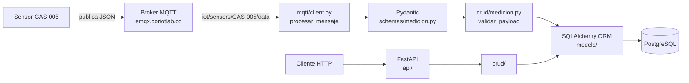

# Taller 2 — API IoT con FastAPI, MQTT y PostgreSQL

## 1. Información General

- **Proyecto:** API para recibir, validar y consultar datos de un sensor IoT (Taller 2)
- **Integrantes:** Luis Carlos Marín Mayo / Jorge Andrés Carvajal Sepúlveda 
- **Asignatura:** Aplicaciones y Servicios Web — Tecnología en Desarrollo de Software
- **Fecha:** 10 de octubre de 2026
- **Sensor asignado:** `GAS-005` (mide `nh3`, `temperature` y `humidity`)
- **Tópico MQTT:** `iot/sensors/GAS-005/data` (broker `emqx.coriotlab.co`, puerto 1883)

## 2. Descripción del Sistema

### Problema que resuelve

El sensor de gas publica sus lecturas por MQTT cada cierto tiempo. Mi aplicación se suscribe al tópico, recibe cada mensaje, revisa que esté bien, guarda en PostgreSQL solo los que son válidos y deja consultarlos desde una API. El broker a veces manda mensajes malos a propósito, así que ningún dato se guarda si no pasa todas las revisiones.

### Arquitectura



La API y el cliente MQTT corren en el mismo proceso. En `app/main.py` el cliente MQTT se inicia cuando arranca FastAPI (con `lifespan`) y se apaga cuando se cierra.

**Qué pasa con cada mensaje MQTT** (`app/mqtt/client.py → procesar_mensaje`):

1. Se lee el JSON. Si no es un JSON válido se rechaza (`[RECHAZADO][JSON]`).
2. **Pydantic** revisa la estructura: que estén los campos, que los tipos sean correctos y que el timestamp tenga buen formato (`[RECHAZADO][ESTRUCTURA]`).
3. Con el **ORM** (`crud/medicion.py → validar_payload`) reviso que el sensor exista y esté activo, que cada magnitud sea de ese sensor, que la unidad coincida con la del catálogo y que el valor esté dentro del rango (`[RECHAZADO][REGLA_NEGOCIO]`).
4. Si **todas** las magnitudes están bien, se guarda **una fila por magnitud** en `mediciones`, todas con el mismo `timestamp_utc` y en una sola transacción, o se guardan todas o ninguna (`[GUARDADO]`).

Los errores de MQTT no devuelven códigos HTTP. Se manejan dentro de `procesar_mensaje` y quedan en el archivo `mqtt.log`.

### Magnitudes y unidades que llegan

| Magnitud | Unidad | Tipo | Rango permitido (catálogo) |
|---|---|---|---|
| `nh3` | `ppm` | número | 0 – 100 |
| `temperature` | `C` | número | 10 – 50 |
| `humidity` | `%` | número | 0 – 100 |

> Los rangos los saqué de `GET /sensores/{id}/magnitudes` (también los imprime `probar_bd.py`).

### Payload real del sensor

Es el primer mensaje que quedó en `mqtt.log`:

```json
{
  "sensor_id": "GAS-005",
  "timestamp": "2026-10-11T02:59:07Z",
  "measurements": {
    "nh3":         { "value": 2.9,   "unit": "ppm" },
    "temperature": { "value": 30.87, "unit": "C"   },
    "humidity":    { "value": 46.17, "unit": "%"   }
  }
}
```

- `sensor_id` es el campo `codigo` de la tabla `sensores`, no la clave primaria `id`.
- `timestamp` es un texto en formato ISO 8601 y en UTC (termina en `Z`). Se guarda en UTC (`TIMESTAMPTZ`) y en los GET se muestra en **hora de Colombia (UTC-5)**, por ejemplo `2026-10-10 21:59:07-05:00`.
- El sensor manda un mensaje cada 5 segundos más o menos.

## 3. Configuración del Entorno

Se necesita Python 3.10 o superior y acceso a PostgreSQL y al broker MQTT que dio el docente.

```powershell
# 1. Clonar el repositorio y cambiar a la rama del taller
git clone https://github.com/LuisKMarin/Taller_2_SERVICIOS_WEB.git
cd Taller_2_SERVICIOS_WEB
git checkout taller-2

# 2. Crear y activar el entorno virtual (Windows PowerShell)
python -m venv venv
.\venv\Scripts\Activate.ps1
#    En Linux/macOS: python3 -m venv venv && source venv/bin/activate

# 3. Instalar las dependencias
pip install -r requirements.txt

# 4. Crear el .env a partir del ejemplo y llenar los valores
copy .env.example .env

# 5. Iniciar la API (también inicia el cliente MQTT)
uvicorn app.main:app
```

En `requirements.txt` quedaron las versiones exactas de cada librería (FastAPI, Pydantic, SQLAlchemy, psycopg2-binary, paho-mqtt, python-dotenv, uvicorn y sus dependencias).

La documentación interactiva queda en http://127.0.0.1:8000/docs.

### Variables de entorno (archivo `.env`, no se sube al repositorio)

| Variable | Para qué sirve |
|---|---|
| `DB_HOST`, `DB_PORT`, `DB_NAME` | Dónde está la base de datos PostgreSQL y cómo se llama |
| `DB_USER`, `DB_PASSWORD` | Usuario y contraseña de la base de datos |
| `MQTT_BROKER`, `MQTT_PORT` | Broker MQTT y su puerto (1883) |
| `MQTT_TOPIC` | Tópico asignado: `iot/sensors/GAS-005/data` |
| `MQTT_USERNAME`, `MQTT_PASSWORD` | Usuario y contraseña del broker |
| `MQTT_KEEPALIVE` | Segundos de keep-alive (60) |
| `SENSOR_CODIGO` | Sensor asignado (`GAS-005`). Cualquier otro sensor se rechaza |

El `.env` está en el `.gitignore`. En el repositorio solo está el `.env.example`, sin valores reales.

## 4. Base de Datos

**Conexión:** en `app/database/connection.py` armo la URL `postgresql+psycopg2://...` con las variables de entorno (la contraseña pasa por `quote_plus` por si trae caracteres raros). Ahí también se crea el `engine` y la función `get_db`, que da una sesión por cada petición y la cierra al final.

**Tablas que uso** (esquema `public`, base `appdb`):

| Tabla | Para qué la uso | Modelo ORM |
|---|---|---|
| `sensores` | Catálogo, solo lectura | `app/models/sensor.py → Sensor` |
| `sensor_magnitudes` | Magnitud, unidad y rango de cada sensor, solo lectura | `app/models/sensor_magnitud.py → SensorMagnitud` |
| `mediciones` | Es la única tabla donde la aplicación guarda datos | `app/models/medicion.py → Medicion` |

**Relaciones:**

- `sensores` 1:N `sensor_magnitudes`: llave foránea `sensor_id → sensores(id)`, con `ON UPDATE CASCADE ON DELETE RESTRICT`.
- `sensor_magnitudes` 1:N `mediciones`: llave foránea `sensor_magnitud_id → sensor_magnitudes(id)`, con `ON UPDATE CASCADE ON DELETE RESTRICT`.
- En el ORM se declaran con `ForeignKey` y `relationship(back_populates=...)`.

**Correspondencia con `data-model.md`:** los modelos tienen los mismos campos y tipos (`SERIAL`, `BIGSERIAL`, `VARCHAR(n)`, `NUMERIC(12,4)`, `TIMESTAMPTZ`, `BOOLEAN`), las mismas restricciones (`UNIQUE(codigo)`, `UNIQUE(sensor_id, magnitud)`, `CHECK (valor_minimo < valor_maximo)`) y los tres índices de `mediciones`. La aplicación **no** crea, modifica ni borra sensores ni magnitudes.

## 5. Organización del Código

```text
app/
├── main.py                 # Crea la app FastAPI, registra los routers, inicia/apaga MQTT y configura el log
├── database/connection.py  # Engine, SessionLocal, clase Base y get_db
├── models/                 # Modelos SQLAlchemy (una clase por tabla)
├── schemas/                # Esquemas Pydantic: validan el mensaje MQTT y dan formato a las respuestas
├── crud/                   # Consultas a la base de datos y reglas de negocio (sin nada de HTTP)
├── api/                    # Routers de FastAPI: rutas, parámetros y códigos HTTP
└── mqtt/client.py          # Cliente MQTT y flujo de validar y guardar
```

| Carpeta | Qué hace |
|---|---|
| `schemas/` | Pydantic revisa que el mensaje esté bien armado (campos, tipos y timestamp ISO con zona). También define cómo se responde, incluyendo el paso de UTC a hora de Colombia. |
| `models/` | Cada tabla de PostgreSQL es una clase, con sus llaves foráneas y relaciones. |
| `crud/` | Consultas por id, código, magnitud, rango de fechas y últimas N. `validar_payload` aplica las reglas de negocio y `crear_mediciones` guarda en una transacción. Los catálogos solo se leen. |
| `api/` | Define los endpoints y convierte los errores en códigos HTTP (404, 400). El 422 lo da FastAPI. |
| `mqtt/` | Se conecta al broker, se suscribe al tópico asignado y procesa cada mensaje. Nunca lanza errores: los deja en el log y descarta el mensaje. |
| `database/` | Configuración de la conexión y de la sesión. |

## 6. Endpoints Implementados

| Método | Ruta | Descripción |
|---|---|---|
| GET | `/` | Estado de la API |
| GET | `/sensores` | Lista los sensores (`skip`, `limit`) |
| GET | `/sensores/{id}` | Un sensor por su id |
| GET | `/sensores/por-codigo/{codigo}` | Un sensor por su código (ej. `GAS-005`) |
| GET | `/sensores/{id}/magnitudes` | Magnitudes, unidades y rangos de un sensor |
| GET | `/sensor-magnitudes/{id}` | Una magnitud de sensor por su id |
| GET | `/mediciones/{id}` | Una medición por su id |
| GET | `/sensores/{id}/mediciones` | Historial con filtros que se pueden combinar: `magnitud`, `desde`, `hasta` y `limit` (últimas N) |
| GET | `/sensores/{id}/ultima-medicion` | Última lectura (una medición por magnitud, con el mismo timestamp) |

Códigos HTTP: `200` bien · `400` cuando `desde > hasta` · `404` si no existe lo que se pide · `422` parámetro inválido · `503` base de datos no disponible. Las fechas se devuelven en hora de Colombia. Los filtros `desde` y `hasta` que vienen sin zona horaria se toman como hora de Colombia.

## 7. Evidencias de Funcionamiento

Las evidencias están en la carpeta [`evidencias/`](evidencias/). Las genero con scripts que están en el repositorio. Son archivos `.txt` porque el `.gitignore` ignora los `.log`.

| Script | Genera | Pruebas |
|---|---|---|
| `python probar_bd.py` | `01_recepcion_mqtt.txt`, `02_17_base_de_datos.txt` | 1, 2, 17 y tiempo de muestreo |
| `python probar_rechazos_mqtt.py` | `03_07_rechazos_mqtt.txt` | 3, 4, 5, 6, 7 |
| `python probar_endpoints.py` | `08_16_endpoints_http.txt` | 8 a 16 |

En cada archivo, por cada prueba, aparece: datos de entrada, resultado, código HTTP cuando aplica, registro guardado o rechazado, archivo y función, y una explicación corta.

| # | Prueba | Evidencia | Archivo y función |
|---|---|---|---|
| 1 | Recepción MQTT | `evidencias/01_recepcion_mqtt.txt` | `app/mqtt/client.py` → `_on_connect`, `_on_message`, `procesar_mensaje` |
| 2 | Medición válida | `evidencias/02_17_base_de_datos.txt` | `app/crud/medicion.py` → `crear_mediciones` |
| 3 | Sensor inexistente | `evidencias/03_07_rechazos_mqtt.txt` | `app/crud/medicion.py` → `validar_payload` |
| 4 | Unidad incorrecta | `evidencias/03_07_rechazos_mqtt.txt` | `app/crud/medicion.py` → `validar_payload` |
| 5 | Tipo de dato incorrecto | `evidencias/03_07_rechazos_mqtt.txt` | `app/schemas/medicion.py` → `MagnitudMQTT.value` (estricto) |
| 6 | Magnitud incorrecta | `evidencias/03_07_rechazos_mqtt.txt` | `app/crud/medicion.py` → `validar_payload` |
| 7 | Timestamp inválido | `evidencias/03_07_rechazos_mqtt.txt` | `app/schemas/medicion.py` → `PayloadMQTT` (validadores de `timestamp`) |
| 8 | Consulta por ID existente | `evidencias/08_16_endpoints_http.txt` | `app/api/sensor.py` → `sensor_por_id`; `app/api/medicion.py` → `medicion_por_id` |
| 9 | Consulta por ID inexistente (`404`) | `evidencias/08_16_endpoints_http.txt` | `app/api/sensor.py` → `obtener_sensor_o_404` |
| 10 | Consulta histórica | `evidencias/08_16_endpoints_http.txt` | `app/api/medicion.py` → `mediciones_de_sensor`; `app/crud/medicion.py` → `get_mediciones_por_sensor` |
| 11 | Rango de fechas | `evidencias/08_16_endpoints_http.txt` | `app/api/medicion.py` → `mediciones_de_sensor`, `_a_utc` |
| 12 | `desde > hasta` (`400`) | `evidencias/08_16_endpoints_http.txt` | `app/api/medicion.py` → `mediciones_de_sensor` |
| 13 | Validación HTTP (`422`) | `evidencias/08_16_endpoints_http.txt` | `SensorId` (`Path ge=1`) y `Query(ge=1)` en `app/api/` |
| 14 | Última medición | `evidencias/08_16_endpoints_http.txt` | `app/api/medicion.py` → `ultima_medicion`; `app/crud/medicion.py` → `get_ultima_lectura` |
| 15 | Últimas N (`limit`) | `evidencias/08_16_endpoints_http.txt` | `app/crud/medicion.py` → `get_mediciones_por_sensor` (`stmt.limit`) |
| 16 | Filtro por magnitud | `evidencias/08_16_endpoints_http.txt` | `app/crud/medicion.py` → `get_mediciones_por_sensor` |
| 17 | Claves foráneas | `evidencias/02_17_base_de_datos.txt` | `app/models/sensor_magnitud.py`, `app/models/medicion.py` → `ForeignKey` |
| 18 | Separación de responsabilidades | Sección 5 de este README | Estructura `schemas/ models/ crud/ api/ mqtt/ database/` |

**Muestreo:** el sensor se escuchó durante **80.6 minutos** en total (275 payloads guardados, cada uno con 3 mediciones). El tramo continuo más largo, sin huecos de más de 60 segundos, fue de **20.3 minutos** (236 payloads), o sea que se cumplen los 20 minutos que pide la guía. `probar_bd.py` lo calcula directamente desde la base de datos y lo escribe en `evidencias/02_17_base_de_datos.txt`.

También dejé los scripts `probar_modelos.py`, `probar_schemas.py` y `probar_crud.py`, que usé para probar cada capa por separado mientras desarrollaba.

## 8. Control de Versiones

- **Repositorio:** https://github.com/LuisKMarin/Taller_2_SERVICIOS_WEB
- **Rama de trabajo:** `taller-2`

| Commit | Fecha | Mensaje |
|---|---|---|
| `41c142f` | 2026-10-10 21:09 | docs: renombrar guía a GUIA.md y crear README base del informe |
| `d13921c` | 2026-10-10 21:14 | chore: estructura inicial, dependencias y requirements.txt |
| `df6d57b` | 2026-10-10 21:39 | feat: modelos ORM, conexión a PostgreSQL y requirements en UTF-8 |
| `f279a02` | 2026-10-10 21:45 | feat: schema Pydantic para validar el payload MQTT |
| `0aa1832` | 2026-10-10 21:52 | feat: CRUD de solo lectura para catálogos y validación y guardado de mediciones |
| `37007d3` | 2026-10-10 22:00 | feat: cliente MQTT que valida, rechaza y guarda mediciones, y arranque con FastAPI |
| `8282062` | 2026-10-10 22:04 | feat: endpoints de sensores, magnitudes y mediciones con hora de Colombia |
| `f00766c` | 2026-10-10 22:29 | test: script probar_bd para evidencias de BD, claves foraneas y 20 min de muestreo |
| `8ae4278` | 2026-10-10 22:29 | test: script que prueba mensajes MQTT invalidos y verifica que no se almacenan |
| `cb746bd` | 2026-10-10 22:29 | test: script que prueba los endpoints HTTP (200, 400, 404, 422) y guarda evidencias |
| `00c55a6` | 2026-10-10 22:58 | feat: endpoints, schemas, scripts de prueba, evidencias y README con datos reales |
| `a7057df` | 2026-10-10 23:24 | docs: evidencias con 20 min de muestreo, README final y .env.example completo |

> El historial completo con los autores se ve con: `git log --format="%h | %an | %ad | %s" --date=short`.

**Aporte de cada integrante:** el trabajo lo hice yo solo (Luis Carlos Marín Mayo): la configuración inicial, los modelos, la conexión a PostgreSQL, los esquemas de Pydantic, el CRUD, el cliente MQTT, los endpoints, los scripts de prueba, las evidencias y este informe. Todos los commits del taller están a mi nombre.

## 9. Conclusiones

**Lo que aprendí**

- Separar el código en `schemas`, `models`, `crud`, `api` y `mqtt` me ayudó a probar cada parte por separado. Por ejemplo, pude probar `procesar_mensaje` sin necesidad de tener el broker.
- Pydantic revisa cómo está armado el mensaje y la base de datos revisa si tiene sentido (que el sensor exista, la magnitud, la unidad y el rango). Cada revisión quedó en la capa que le corresponde.
- Guardar una fila por magnitud en una sola transacción hace que se cumpla lo de «todo o nada» y que todas tengan el mismo `timestamp_utc`.

**Dificultades y cómo las resolví**

- *Pydantic aceptaba datos que no debía:* por defecto convierte `"24.6"` en número y deja pasar un número como si fuera fecha. Lo arreglé con tipos estrictos (`strict=True`), rechazando `NaN` e infinito y con un validador que pide el timestamp como texto ISO con zona.
- *Zona horaria:* el sensor manda la hora en UTC y las respuestas debían salir en hora de Colombia. Guardo `TIMESTAMPTZ` en UTC y hago la conversión al devolver los datos (UTC-5, Colombia no tiene horario de verano).
- *Codificación de `requirements.txt`:* el archivo que generó Windows no quedó en UTF-8 y tuve que volver a generarlo (commit `df6d57b`).
- *Orden de las rutas:* `/sensores/por-codigo/{codigo}` va antes de `/sensores/{id}`, porque si no la captura la ruta numérica.
- *Muestreo de 20 minutos:* mirar solo la primera y la última medición engaña si la API se apagó un rato. Por eso `probar_bd.py` calcula el tramo continuo más largo (sin huecos de más de 60 segundos) y solo da por cumplido el requisito si llega a 20 minutos.
- *Evidencias y `.gitignore`:* como los `.log` están ignorados, guardé las evidencias en archivos `.txt` para que sí se suban al repositorio.
