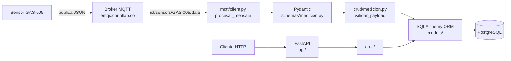

# Taller 2 — API IoT con FastAPI, MQTT y PostgreSQL

> **Antes de entregar:** busca con `Ctrl+F` el texto **[COMPLETAR]** (datos del muestreo de 20 minutos) y borra esta nota.

## 1. Información General

- **Proyecto:** API para adquisición, validación y consulta de datos IoT (Taller 2)
- **Integrantes:** Luis Carlos Marín Mayo / JorgeJorge Andrés Carvajal Sepúlveda
- **Asignatura:** Aplicaciones y Servicios Web — Tecnología en Desarrollo de Software
- **Fecha:** 10 de octubre de 2026
- **Sensor asignado:** `GAS-005` (mide `nh3`, `temperature` y `humidity`)
- **Tópico MQTT:** `iot/sensors/GAS-005/data` (broker `emqx.coriotlab.co`, puerto 1883)

## 2. Descripción del Sistema

### Problema resuelto

Un sensor de gas publica periódicamente sus lecturas por MQTT. La aplicación debe recibirlas, comprobar que son correctas, guardar solo las válidas en PostgreSQL y permitir consultarlas por HTTP. El broker puede enviar mensajes inválidos a propósito, por lo que ninguna lectura se guarda sin pasar todas las validaciones.

### Arquitectura implementada



La API y el suscriptor MQTT corren en el mismo proceso: `app/main.py` inicia el suscriptor en un hilo propio mediante el `lifespan` de FastAPI y lo detiene al cerrar.

**Flujo de cada mensaje MQTT** (`app/mqtt/client.py → procesar_mensaje`):

1. Decodifica el JSON. Si no es JSON válido → `[RECHAZADO][JSON]`.
2. **Pydantic** valida la estructura: campos obligatorios, tipos y formato del timestamp → `[RECHAZADO][ESTRUCTURA]`.
3. **ORM + lógica de negocio** (`crud/medicion.py → validar_payload`) verifica: el sensor existe, está activo, cada magnitud pertenece al sensor, la unidad coincide con el catálogo y el valor está dentro del rango → `[RECHAZADO][REGLA_NEGOCIO]`.
4. Si **todas** las magnitudes son válidas, guarda **una fila por magnitud** en `mediciones`, todas con el mismo `timestamp_utc`, en una sola transacción (todo o nada) → `[GUARDADO]`.

Los errores MQTT no devuelven códigos HTTP: se manejan dentro de `procesar_mensaje` y quedan registrados en `mqtt.log`.

### Magnitudes y unidades recibidas

| Magnitud | Unidad | Tipo | Rango permitido (catálogo) |
|---|---|---|---|
| `nh3` | `ppm` | número | 0 – 100 |
| `temperature` | `C` | número | 10 – 50 |
| `humidity` | `%` | número | 0 – 100 |

> Los rangos salen de `GET /sensores/{id}/magnitudes` (o de la salida de `probar_bd.py`, que también los imprime).

### Payload real del sensor

Tomado de `mqtt.log` (primer mensaje recibido):

```json
{
  "sensor_id": "GAS-005",
  "timestamp": "2026-10-11T02:59:07Z",
  "measurements": {
    "nh3":         { "value": 2.9,   "unit": "ppm" },
    "temperature": { "value": 30.87, "unit": "C"   },
    "humidity":    { "value": 46.17, "unit": "%"   }
  }
}
```

- `sensor_id` corresponde al campo `codigo` de la tabla `sensores`, **no** a su clave primaria `id`.
- `timestamp` es texto ISO 8601 en UTC (termina en `Z`). Se almacena en UTC (`TIMESTAMPTZ`) y se convierte a **hora de Colombia (UTC-5)** en las respuestas GET, con el formato `2026-10-10 21:59:07-05:00`.
- El sensor publica un mensaje cada ~5 segundos.

## 3. Configuración del Entorno

Requisitos: Python 3.10 o superior, acceso a PostgreSQL y al broker MQTT suministrados por el docente.

```powershell
# 1. Clonar y entrar a la rama del taller
git clone https://github.com/LuisKMarin/Taller_2_SERVICIOS_WEB.git
cd Taller_2_SERVICIOS_WEB
git checkout taller-2

# 2. Crear y activar el entorno virtual (Windows PowerShell)
python -m venv venv
.\venv\Scripts\Activate.ps1
#    En Linux/macOS: python3 -m venv venv && source venv/bin/activate

# 3. Instalar las dependencias
pip install -r requirements.txt

# 4. Crear el .env a partir del ejemplo y completar los valores
copy .env.example .env

# 5. Iniciar la API (también inicia el suscriptor MQTT)
uvicorn app.main:app
```

`requirements.txt` fija la versión exacta de cada dependencia (FastAPI, Pydantic, SQLAlchemy, psycopg2-binary, paho-mqtt, python-dotenv, uvicorn y sus dependencias).

La documentación interactiva queda en http://127.0.0.1:8000/docs.

### Variables de entorno (archivo `.env`, **no** se sube al repositorio)

| Variable | Descripción |
|---|---|
| `DB_HOST`, `DB_PORT`, `DB_NAME` | Ubicación y nombre de la base PostgreSQL |
| `DB_USER`, `DB_PASSWORD` | Credenciales de la base de datos |
| `MQTT_BROKER`, `MQTT_PORT` | Broker MQTT y puerto (1883) |
| `MQTT_TOPIC` | Tópico asignado: `iot/sensors/GAS-005/data` |
| `MQTT_USERNAME`, `MQTT_PASSWORD` | Credenciales del broker |
| `MQTT_KEEPALIVE` | Segundos de keep-alive (60) |
| `SENSOR_CODIGO` | Sensor asignado al grupo (`GAS-005`); se rechaza cualquier otro |

`.env` está en el `.gitignore`; el repositorio solo incluye `.env.example` sin valores reales.

## 4. Base de Datos

**Conexión:** `app/database/connection.py` arma la URL `postgresql+psycopg2://…` con las variables de entorno (la contraseña se codifica con `quote_plus`), crea el `engine` con `pool_pre_ping=True` y entrega una sesión por petición con la dependencia `get_db`.

**Tablas utilizadas** (esquema `public`, base `appdb`):

| Tabla | Uso en la aplicación | Modelo ORM |
|---|---|---|
| `sensores` | Catálogo (solo lectura) | `app/models/sensor.py → Sensor` |
| `sensor_magnitudes` | Catálogo de magnitud, unidad y rango por sensor (solo lectura) | `app/models/sensor_magnitud.py → SensorMagnitud` |
| `mediciones` | Única tabla donde la aplicación inserta | `app/models/medicion.py → Medicion` |

**Relaciones implementadas:**

- `sensores` 1:N `sensor_magnitudes` — FK `sensor_id → sensores(id)`, `ON UPDATE CASCADE ON DELETE RESTRICT`.
- `sensor_magnitudes` 1:N `mediciones` — FK `sensor_magnitud_id → sensor_magnitudes(id)`, `ON UPDATE CASCADE ON DELETE RESTRICT`.
- En el ORM se declaran con `ForeignKey` y `relationship(back_populates=…)`.

**Correspondencia con `data-model.md`:** los campos, tipos (`SERIAL`, `BIGSERIAL`, `VARCHAR(n)`, `NUMERIC(12,4)`, `TIMESTAMPTZ`, `BOOLEAN`), restricciones (`UNIQUE(codigo)`, `UNIQUE(sensor_id, magnitud)`, `CHECK (valor_minimo < valor_maximo)`) y los tres índices de `mediciones` están reflejados en los modelos. La aplicación **no** crea, modifica ni elimina sensores ni magnitudes.

## 5. Organización del Código

```text
app/
├── main.py                 # Crea la app FastAPI, registra routers, arranca/detiene MQTT, configura el log
├── database/connection.py  # Engine, SessionLocal, clase Base y get_db
├── models/                 # Modelos SQLAlchemy ORM (una clase por tabla)
├── schemas/                # Esquemas Pydantic: validación del payload MQTT y formato de las respuestas
├── crud/                   # Acceso a datos y reglas de negocio (sin lógica HTTP)
├── api/                    # Routers FastAPI: rutas, parámetros y códigos HTTP
└── mqtt/client.py          # Suscriptor MQTT y flujo de validación/almacenamiento
```

| Carpeta | Responsabilidad |
|---|---|
| `schemas/` | Pydantic valida **la forma** del mensaje (campos, tipos estrictos, timestamp ISO con zona) y define las respuestas, incluida la conversión UTC → hora de Colombia. |
| `models/` | Representan las tablas de PostgreSQL como clases, con claves foráneas y relaciones. |
| `crud/` | Consultas por id, código, magnitud, rango y últimas N; `validar_payload` aplica las reglas de negocio y `crear_mediciones` guarda en una transacción. Solo lectura para los catálogos. |
| `api/` | Define los endpoints y traduce los casos de error a códigos HTTP (404, 400); FastAPI aporta el 422. |
| `mqtt/` | Se conecta al broker, se suscribe al tópico asignado y procesa cada mensaje; nunca lanza excepciones: registra y descarta. |
| `database/` | Configuración de la conexión y de la sesión. |

## 6. Endpoints Implementados

| Método | Ruta | Descripción |
|---|---|---|
| GET | `/` | Estado de la API |
| GET | `/sensores` | Lista los sensores (`skip`, `limit`) |
| GET | `/sensores/{id}` | Sensor por clave primaria |
| GET | `/sensores/por-codigo/{codigo}` | Sensor por código (ej. `GAS-005`) |
| GET | `/sensores/{id}/magnitudes` | Magnitudes, unidades y rangos de un sensor |
| GET | `/sensor-magnitudes/{id}` | Una magnitud de sensor por id |
| GET | `/mediciones/{id}` | Una medición por id |
| GET | `/sensores/{id}/mediciones` | Histórico con filtros combinables: `magnitud`, `desde`, `hasta`, `limit` (últimas N) |
| GET | `/sensores/{id}/ultima-medicion` | Última lectura (una medición por magnitud, mismo timestamp) |

Códigos HTTP: `200` correcto · `400` `desde > hasta` · `404` recurso inexistente · `422` parámetro inválido · `503` base de datos no disponible. Las fechas se devuelven en hora de Colombia; los filtros `desde`/`hasta` sin zona horaria se interpretan como hora de Colombia.

## 7. Evidencias de Funcionamiento

Las evidencias están en la carpeta [`evidencias/`](evidencias/) y se generan con scripts incluidos en el repositorio (los archivos son `.txt` porque el `.gitignore` excluye `*.log`):

| Script | Genera | Pruebas |
|---|---|---|
| `python probar_bd.py` | `01_recepcion_mqtt.txt`, `02_17_base_de_datos.txt` | 1, 2, 17 y tiempo de muestreo |
| `python probar_rechazos_mqtt.py` | `03_07_rechazos_mqtt.txt` | 3, 4, 5, 6, 7 |
| `python probar_endpoints.py` | `08_16_endpoints_http.txt` | 8 a 16 |

Cada archivo indica, por prueba: datos de entrada, resultado, código HTTP cuando aplica, registro almacenado o rechazado, archivo y función, y una breve explicación.

| # | Prueba | Evidencia | Archivo y función donde se implementa |
|---|---|---|---|
| 1 | Recepción MQTT | `evidencias/01_recepcion_mqtt.txt` | `app/mqtt/client.py` → `_on_connect`, `_on_message`, `procesar_mensaje` |
| 2 | Medición válida | `evidencias/02_17_base_de_datos.txt` | `app/crud/medicion.py` → `crear_mediciones` |
| 3 | Sensor inexistente | `evidencias/03_07_rechazos_mqtt.txt` | `app/crud/medicion.py` → `validar_payload` |
| 4 | Unidad incorrecta | `evidencias/03_07_rechazos_mqtt.txt` | `app/crud/medicion.py` → `validar_payload` |
| 5 | Tipo de dato incorrecto | `evidencias/03_07_rechazos_mqtt.txt` | `app/schemas/medicion.py` → `MagnitudMQTT.value` (estricto) |
| 6 | Magnitud incorrecta | `evidencias/03_07_rechazos_mqtt.txt` | `app/crud/medicion.py` → `validar_payload` |
| 7 | Timestamp inválido | `evidencias/03_07_rechazos_mqtt.txt` | `app/schemas/medicion.py` → `PayloadMQTT` (validadores de `timestamp`) |
| 8 | Consulta por ID existente | `evidencias/08_16_endpoints_http.txt` | `app/api/sensor.py` → `sensor_por_id`; `app/api/medicion.py` → `medicion_por_id` |
| 9 | Consulta por ID inexistente (`404`) | `evidencias/08_16_endpoints_http.txt` | `app/api/sensor.py` → `obtener_sensor_o_404` |
| 10 | Consulta histórica | `evidencias/08_16_endpoints_http.txt` | `app/api/medicion.py` → `mediciones_de_sensor`; `app/crud/medicion.py` → `get_mediciones_por_sensor` |
| 11 | Rango de fechas | `evidencias/08_16_endpoints_http.txt` | `app/api/medicion.py` → `mediciones_de_sensor`, `_a_utc` |
| 12 | `desde > hasta` (`400`) | `evidencias/08_16_endpoints_http.txt` | `app/api/medicion.py` → `mediciones_de_sensor` |
| 13 | Validación HTTP (`422`) | `evidencias/08_16_endpoints_http.txt` | `SensorId` (`Path ge=1`) y `Query(ge=1)` en `app/api/` |
| 14 | Última medición | `evidencias/08_16_endpoints_http.txt` | `app/api/medicion.py` → `ultima_medicion`; `app/crud/medicion.py` → `get_ultima_lectura` |
| 15 | Últimas N (`limit`) | `evidencias/08_16_endpoints_http.txt` | `app/crud/medicion.py` → `get_mediciones_por_sensor` (`stmt.limit`) |
| 16 | Filtro por magnitud | `evidencias/08_16_endpoints_http.txt` | `app/crud/medicion.py` → `get_mediciones_por_sensor` |
| 17 | Claves foráneas | `evidencias/02_17_base_de_datos.txt` | `app/models/sensor_magnitud.py`, `app/models/medicion.py` → `ForeignKey` |
| 18 | Separación de responsabilidades | Sección 5 de este README | Estructura `schemas/ models/ crud/ api/ mqtt/ database/` |

**Muestreo:** el sensor se escuchó de forma continua durante **[COMPLETAR: N] minutos** (**[COMPLETAR: N]** payloads guardados, cada uno con 3 mediciones), por encima de los 20 minutos exigidos. `probar_bd.py` calcula el *tramo continuo más largo* (sin huecos de más de 60 s) directamente desde la base de datos y lo escribe en `evidencias/02_17_base_de_datos.txt`.

Scripts de apoyo usados durante el desarrollo: `probar_modelos.py`, `probar_schemas.py` y `probar_crud.py` (comprueban cada capa por separado).

## 8. Control de Versiones

- **Repositorio:** https://github.com/LuisKMarin/Taller_2_SERVICIOS_WEB
- **Rama de trabajo:** `taller-2`

| Commit | Fecha | Mensaje |
|---|---|---|
| `41c142f` | 2026-10-10 21:09 | docs: renombrar guía a GUIA.md y crear README base del informe |
| `d13921c` | 2026-10-10 21:14 | chore: estructura inicial, dependencias y requirements.txt |
| `df6d57b` | 2026-10-10 21:39 | feat: modelos ORM, conexión a PostgreSQL y requirements en UTF-8 |
| `f279a02` | 2026-10-10 21:45 | feat: schema Pydantic para validar el payload MQTT |
| `0aa1832` | 2026-10-10 21:52 | feat: CRUD de solo lectura para catálogos y validación y guardado de mediciones |
| `37007d3` | 2026-10-10 22:00 | feat: cliente MQTT que valida, rechaza y guarda mediciones, y arranque con FastAPI |
| `8282062` | 2026-10-10 22:04 | feat: endpoints de sensores, magnitudes y mediciones con hora de Colombia |
| `f00766c` | 2026-10-10 22:29 | test: script probar_bd para evidencias de BD, claves foraneas y 20 min de muestreo |
| `8ae4278` | 2026-10-10 22:29 | test: script que prueba mensajes MQTT invalidos y verifica que no se almacenan |
| `cb746bd` | 2026-10-10 22:29 | test: script que prueba los endpoints HTTP (200, 400, 404, 422) y guarda evidencias |

> Para ver el historial completo y los autores: `git log --format="%h | %an | %ad | %s" --date=short`.

**Aporte de cada integrante:** el trabajo fue individual. Luis Carlos Marín Mayo realizó todo el proyecto: configuración inicial, modelos ORM, conexión a PostgreSQL, esquemas Pydantic, CRUD, cliente MQTT, endpoints FastAPI, scripts de prueba, evidencias y este informe. Todos los commits del taller están a su nombre.

## 9. Conclusiones

**Principales aprendizajes**

- Separar responsabilidades (`schemas`, `models`, `crud`, `api`, `mqtt`) permitió probar cada capa por separado, por ejemplo `procesar_mensaje` sin necesidad de un broker.
- Pydantic valida la **forma** del mensaje y la base de datos valida el **significado** (sensor, magnitud, unidad, rango); cada validación vive en la capa que corresponde.
- Guardar una fila por magnitud en una sola transacción garantiza la regla «todo o nada» y que todas compartan el mismo `timestamp_utc`.

**Dificultades y soluciones**

- *Pydantic aceptaba datos que no debía:* por defecto convierte `"24.6"` en número y acepta un entero como fecha. Se resolvió con tipos estrictos (`strict=True`), rechazo de `NaN`/infinito y un validador que exige el timestamp como texto ISO con zona.
- *Zona horaria:* el sensor publica en UTC y las respuestas deben mostrar hora de Colombia. Se almacena `TIMESTAMPTZ` en UTC y la conversión se hace al serializar (`UTC-5`, sin horario de verano).
- *Codificación de `requirements.txt`:* el archivo generado en Windows no estaba en UTF-8 y hubo que regenerarlo (commit `df6d57b`).
- *Rutas con parámetros:* `/sensores/por-codigo/{codigo}` se declara antes que `/sensores/{id}` para que no la capture la ruta numérica.
- *Muestreo de 20 minutos:* medir solo «primera y última medición» engaña si la API se detuvo a ratos, así que `probar_bd.py` calcula el tramo continuo más largo (sin huecos de más de 60 s) y solo da por cumplido el requisito si llega a 20 minutos.
- *Evidencias y `.gitignore`:* como `*.log` está ignorado, las evidencias se guardan en `.txt` para que sí lleguen al repositorio.